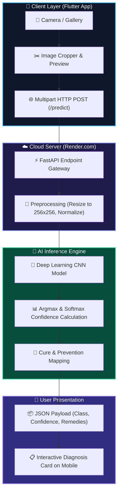

# 🌿 LeafMD – AI Plant Disease Diagnosis System

[](https://drive.google.com/file/d/1aRWoSLHJe0gYo9M21WRpYLrDX_EUZzX7/view?usp=sharing)
[](https://leafmd-api.onrender.com)
[](https://github.com/Ace-1111/leafmd-mobile-app)
[](https://github.com/Ace-1111/plant-disease-backend)

An intelligent, cloud-connected mobile health companion for crops. Farmers and gardeners can snap photos of infected plant leaves and receive instant AI diagnosis with cure recommendations.

---

## 📲 Try the App (Instant Install)

Direct ready-to-use APK download karke apne Android phone par install karein:

👉 **[📥 Download LeafMD APK (Latest Release)](https://drive.google.com/file/d/1aRWoSLHJe0gYo9M21WRpYLrDX_EUZzX7/view?usp=sharing)**

> **Note:** Install karte samay agar *"Install from Unknown Sources"* ya *"Play Protect Warning"* aaye, toh **Install anyway** select karein.

---

## ✨ Features
* 📸 **Capture & Gallery Upload:** Instant leaf capture via phone camera or gallery selector.
* ✂️ **Interactive Cropping:** Crop precisely to the diseased foliage spot for maximum AI accuracy.
* ⚡ **Live Cloud Classification:** Connected 24/7 to our containerized FastAPI backend on Render.
* 🛡️ **Remedies & Advice:** Provides organic & chemical remedies alongside the confidence score.

---

## 🛠️ Tech Stack
* **Frontend:** Flutter (Dart)
* **Backend:** FastAPI (Python)
* **Tools:** `image_picker`, `image_cropper`, `flutter_launcher_icons`
* **Live API Backend:** [leafmd-api on Render](https://leafmd-api.onrender.com)
* **Backend Source Code:** [plant-disease-backend](https://github.com/Ace-1111/plant-disease-backend)

---

## 🚀 Run Locally

### Prerequisites
* Flutter SDK installed
* Android Studio / VS Code

### Steps
```bash
git clone https://github.com/Ace-1111/leafmd-mobile-app.git
cd leafmd-mobile-app
flutter pub get
flutter run
```
---

## 🏛️ System Architecture


